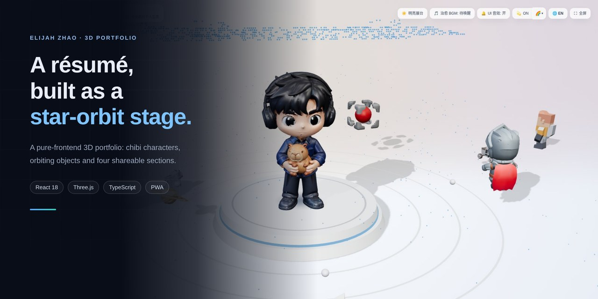
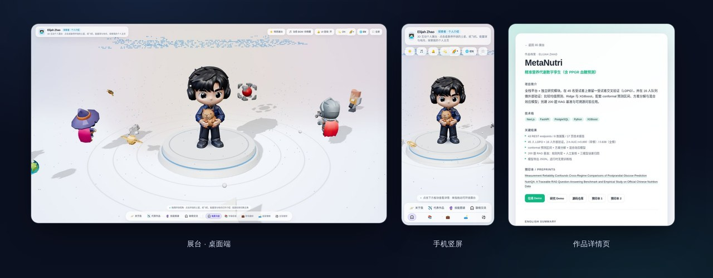
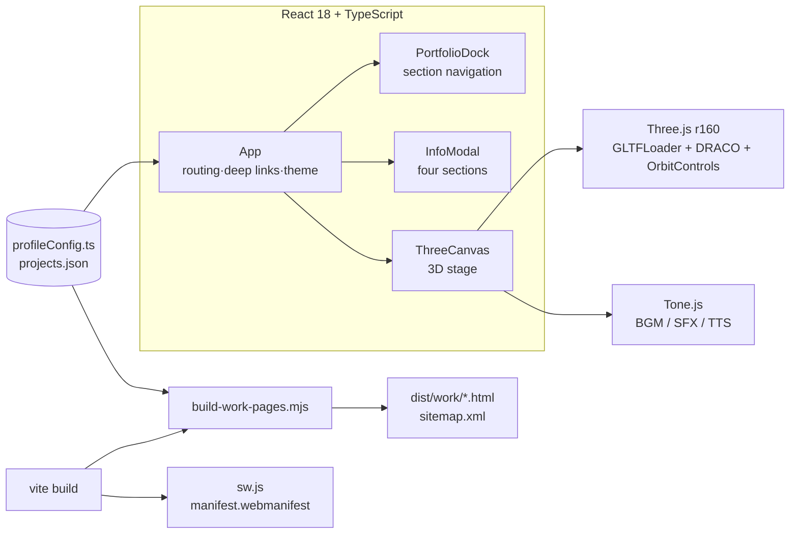

<p align="center">
  <a href="https://elijahzhao.github.io/Self-Introduction/">
    
  </a>
</p>

<h1 align="center">Interactive 3D Avatar Portfolio</h1>

<p align="center">
  <strong>A hand-crafted 3D portfolio that turns a résumé into a star-orbit stage.</strong><br />
  Four shareable sections · bilingual UI · graceful WebGL2 fallback · PWA offline shell · zero backend
</p>

<p align="center">
  <a href="https://github.com/ElijahZhao/Self-Introduction/actions/workflows/deploy.yml">
    
  </a>
  
  
  
</p>

<p align="center">
  <a href="https://elijahzhao.github.io/Self-Introduction/"><strong>🚀 Live Demo</strong></a> ·
  <a href="https://elijahzhao.github.io/Self-Introduction/?p=about">About</a> ·
  <a href="https://elijahzhao.github.io/Self-Introduction/?p=projects">Projects</a> ·
  <a href="https://elijahzhao.github.io/Self-Introduction/?p=hobbies">Skills</a> ·
  <a href="https://elijahzhao.github.io/Self-Introduction/?p=contact">Contact</a>
</p>

<p align="center">
  <a href="README.md">简体中文</a> | English
</p>

---

## Contents

- [What is this](#what-is-this)
- [Screens](#screens)
- [What it does](#what-it-does)
- [Architecture](#architecture)
- [Quick start](#quick-start)
- [Quality gates](#quality-gates)
- [Content as configuration](#content-as-configuration)
- [Deployment and offline](#deployment-and-offline)
- [Known limits](#known-limits)
- [Maintenance status](#maintenance-status)
- [License and assets](#license-and-assets)

<a id="what-is-this"></a>

## What is this

A 3D portfolio you can open, drag and click through. Instead of another wall of text, it is a star-orbit stage: five chibi characters make a staggered entrance, Saturn, a paper plane, Earth & Moon and an energy orb orbit the stage, and opening any orbiting object reveals the matching section.

- **Four sections** — About, Projects, Skills, Contact — each with its own shareable URL (`?p=about`, etc.).
- **Seven project pages** — beyond the in-scene cards, the build generates a static, crawlable page per project at `/work/<slug>.html`.
- **Two languages** — Chinese and English switch at runtime, and `<html lang>` follows.
- **No backend** — no server, database or third-party UI service; the build output is static and hosted on GitHub Pages.

It is for developers who want to see how a 3D interaction is engineered, and for anyone who wants the short version of the author's background without reading a long document.

> Stack: React 18 · TypeScript 5.6 · Vite 6 · Three.js r160 · Tone.js · Tailwind CSS v4 · GSAP.

<a id="screens"></a>

## Screens

<p align="center">
  <a href="https://elijahzhao.github.io/Self-Introduction/">
    
  </a>
</p>

<p align="center">
  <sub>Left: desktop orbit stage and persona dock · Middle: a separate portrait framing · Right: a zero-JS project page generated at build time</sub>
</p>

<a id="what-it-does"></a>

## What it does

| Capability | How it works | How it is verified |
|---|---|---|
| 3D orbit stage | A Three.js scene with `OrbitControls`; idle breathing driven by `characterPivot`; four interactive objects plus nine decorative ones on concentric orbits | Three canvases (stage, aurora backdrop, fluid cursor) and zero `pageerror` |
| Characters and personas | Five GLB characters switched from the bottom dock; the other four are prefetched once the active one is ready | The choice persists in `localStorage`; switching avoids a second network round-trip |
| Sound | Tone.js synthesises BGM and UI sounds; modals prefer recorded voice, then fall back to Web Speech API | AudioContext resumes on the first gesture |
| Failure handling | `ErrorBoundary` + `StageFallback` for four reasons (no WebGL2, context lost, model failure, component error), with retry and a text-only entry | WebGL2 disabled, `WEBGL_lose_context`, and model 404 all produce a readable card |
| Mobile | A separate portrait framing (`orbitWorld` + 0.6 scale), scroll hint in modals, and the phone back button closes the card instead of leaving the site | Screenshot comparison at 390×844 and 1440×900 |
| Discoverability | A visually hidden but crawlable intro in `index.html`, `Person` / `WebSite` JSON-LD, robots, sitemap and seven static project pages | Crawlers see text; `/work/*.html` returns 200 |
| Offline and analytics | Manifest plus a hand-written Service Worker; analytics stay silent until `VITE_ANALYTICS_ENDPOINT` is set, with no cookies and DNT respected | Offline reload of the home and project pages returns 200; the default build contains no endpoint string |

<a id="architecture"></a>

## Architecture



The build order is fixed:

```text
tsc → vite build → build-work-pages → build-pwa → size budget
```

If any step fails, GitHub Actions does not deploy.

<a id="quick-start"></a>

## Quick start

Node.js 20+ is required. No environment variables are needed.

```bash
git clone https://github.com/ElijahZhao/Self-Introduction.git
cd Self-Introduction
npm ci
npm run dev
```

Open `http://localhost:5173`. To build and preview the production output:

```bash
npm run build
npx vite preview --port 4173
```

Common commands:

| Command | Purpose |
|---|---|
| `npm run dev` | Dev server with HMR |
| `npm run build` | Typecheck, build, generate project pages, write `sw.js` |
| `npm run typecheck` | `tsc --noEmit` only |
| `npm run lint` | ESLint with `--max-warnings 0` |
| `npm run test` | Vitest unit tests for pure logic |
| `npm run test:e2e` | Playwright smoke: stage, deep link, back button, theme, language |
| `npm run check:content` | Validate `projects.json` schema and unique slugs |
| `npm run check:size` | Bundle-size budget; fails when exceeded |

<a id="quality-gates"></a>

## Quality gates

Numbers below are from the 2026-11-26 build. CI re-runs every step:

| Gate | Current result |
|---|---|
| TypeScript | `tsc --noEmit` passes |
| ESLint | 0 errors / 0 warnings (`--max-warnings 0`) |
| Unit tests | 13 passed (`vitest`) |
| End-to-end | 3 passed (`playwright`, zh-CN) |
| Content schema | `projects.json OK.` (7 projects, unique slugs) |
| Bundle size | 10.04 MiB total · 1172 KiB app JS · 613 KiB largest chunk · 44 KiB CSS |
| Deployment | `Deploy to GitHub Pages` runs automatically on `main` |

The budget lives in `scripts/check-dist-size.mjs`: total ≤ 12 MiB, app JS ≤ 1.25 MiB, largest chunk ≤ 0.65 MiB, CSS ≤ 60 KiB. A single overshoot fails the build, so "optimise later" cannot quietly become "never".

<a id="content-as-configuration"></a>

## Content as configuration

Project cards are not hard-coded in components. They live in [`src/data/projects.json`](src/data/projects.json):

```json
{
  "version": 2,
  "updatedAt": "2026-11-26",
  "projects": [
    {
      "slug": "cinerec",
      "name": "CineRec",
      "tagline": "Multimodal movie recommender",
      "desc": "...",
      "tech": ["Python", "PyTorch", "FastAPI"],
      "highlights": ["..."],
      "repoUrl": "https://github.com/ElijahZhao/cinerec",
      "papers": [
        { "title": "CineRec: A Practical Multi-Modal Recommender Study...", "url": "https://doi.org/..." }
      ]
    }
  ]
}
```

- `slug` is unique (kebab-case) and defines the static page URL `/work/<slug>.html`. Editing this one file rebuilds the detail pages and `sitemap.xml`.
- Optional `papers` renders a “Preprint” entry and adds the DOI to the page's `CreativeWork` `citation`.
- `npm run check:content` runs before the build in CI; a bad field, duplicate slug or invalid URL fails the deploy.

<a id="deployment-and-offline"></a>

## Deployment and offline

- **Deployment**: pushing to `main` triggers typecheck → lint → unit → content schema → build → size budget → e2e, then uploads the Pages artifact. See [`.github/workflows/deploy.yml`](.github/workflows/deploy.yml).
- **PWA**: the build emits `manifest.webmanifest` and `sw.js` (a new cache id per build; old caches are removed on activate). Navigations are network-first so an old HTML shell never hides a new deploy; `/assets/`, `/models/`, `/draco/` and `/audio/` are stale-while-revalidate. The Service Worker is registered in production only.
- **Analytics (off by default)**: only enabled when `VITE_ANALYTICS_ENDPOINT` is set at build time. The payload contains `event / path / lang / ts / detail` — no cookies, no visitor IDs — and Do Not Track is respected. Events: `page_view`, `module_open`, `persona_switch`, `project_page_open`.
- **Deep links**: `?p=about`, `?p=projects`, `?p=hobbies`, `?p=contact`. `Esc` or the phone back button closes the card without leaving the page.

<a id="known-limits"></a>

## Known limits

- **WebGL2 is required**: without it the site does not go blank, but only the text fallback remains.
- **Models cost bytes on first load**: `dist` is about 10 MiB. On a normal link the overlay waits for the character, Saturn, Earth & Moon and the energy orb; on a constrained link it waits only for the character and the orb, with decorations streaming in the background.
- **Content changes need a rebuild**: there is no CMS or backend; edit `projects.json` and redeploy.
- **Characters are static GLBs**: no skeletal animation; breathing and entrances are transform/tween driven. Replacing a character means re-running decimation, WebP textures and Draco compression.
- **Single maintainer**: update cadence depends on the author's time, but CI keeps every commit from breaking the build or the smoke tests.

<a id="maintenance-status"></a>

## Maintenance status

| Status | Items |
|---|---|
| ✅ Shipped | Deep links and back button, crawlable static content, PWA offline shell, project pages, content schema, opt-in analytics, e2e and size budget |
| ⏸️ Deferred | Character GLB replacement, dual lockfile cleanup, real-device entrance timing, long-term expansion (all explicitly out of scope for now) |
| 💬 Welcome | Bug reports, copy fixes, accessibility suggestions — please open an [Issue](https://github.com/ElijahZhao/Self-Introduction/issues) |

<a id="license-and-assets"></a>

## License and assets

- **Code**: MIT, see [LICENSE](LICENSE).
- **Third-party assets**: not covered by MIT. Full sources, sizes, triangle counts and licence obligations are in [`docs/ASSETS.md`](docs/ASSETS.md).
- **Attribution that must be kept**: `Wolf.glb` is **CC-BY 4.0** — credit [vinceyanez](https://sketchfab.com/vinceyanez) when redistributing or deriving from it. Quaternius / Kenney / KayKit assets are CC0-1.0; the five character models and voice files are copyright the author.

<p align="center">
  <sub>Built with React, Three.js and too many orbit calculations.</sub>
</p>
