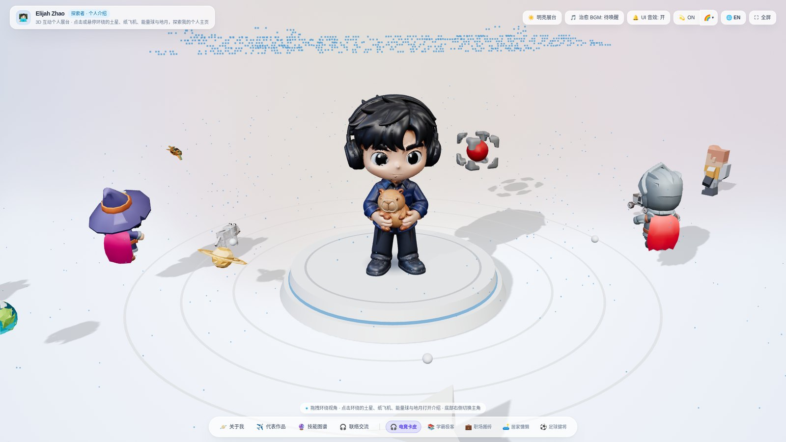

# 🪐 3D 互动个人星轨展台 (Interactive 3D Avatar Portfolio)



采用 **React + Vite + TypeScript + Three.js + Tone.js + Tailwind CSS** 构建的轻量级游戏化 3D 个人展台与介绍网站，**纯前端、零后端架构**，可直接本地运行或构建静态文件部署至 GitHub Pages、Vercel 等平台。

## ✨ 核心功能亮点

1. **5 个 Q 版手办主角团（底部导航坞切换，默认「电竞抱卡皮巴拉版」）**
   - 角色模型为静态 GLB（无骨骼动画），待机呼吸浮动由 `ThreeCanvas` 的 `characterPivot` 位移实现。
   - 场景支持 **OrbitControls 视角漫游**：拖拽环绕场景、滚轮/双指缩放，俯仰与距离受限防止穿地穿模。
2. **4 大交互环绕物 + 9 个装饰环绕物 + 同心发光星轨 + 声波涟漪弹窗**
   - **🪐 土星（关于我）**、**✈️ 折纸飞机（作品与经历）**、**🎧 地月（联络交流）**、**🔮 能量球（技能图谱）** 沿轨道环绕运行，点击触发声波涟漪弹窗。
   - **纯装饰环绕物**（不参与交互）：🪨 小行星、🚀 小飞船、🛰️ 月球车、🚙 探索车（[Quaternius Ultimate Space Kit](https://quaternius.com/packs/ultimatespacekit.html) CC0-1.0）；🏎️ 悬浮快艇、📡 卫星天线、🧑‍🚀 宇航员、⛏️ 采矿船、☄️ 陨石（[Kenney Space Kit](https://kenney.nl/assets/space-kit) CC0-1.0，静态 GLB、顶点色无贴图），沿内外层轨道点缀。
   - **🛸 无人机列阵欢迎文字**：场景前方悬浮"欢迎来访者"粒子文字（Canvas 像素采样生成），缓慢浮动呼吸；**悬停时粒子放大，点击触发粒子绽放 + 欢迎语播报**。
3. **三层声音交互系统**
   - **全局治愈 BGM**：基于 [Tone.js](https://github.com/Tonejs/Tone.js) 实时合成轻柔钢琴/八音盒旋律。
   - **清脆游戏 UI 音效**：悬停、点击水滴声波、弹窗开合音效。
   - **弹窗 🔊 真人语音 / 智能中文朗读（TTS）**：优先播放配置的真人语音文件，未配置时调用浏览器原生 Web Speech API 朗读卡片内容。
4. **页面活力装饰**（不参与交互）
   - WebGL2 极光背景（`AuroraBackground`）、全屏流体光标（`SplashCursor`）、GSAP 入场动画、场景内环绕粒子场。

## 🧸 3D 主角团与模型来源

5 个 Q 版手办角色由需求方自备，**来源链（披露）**：

> **即梦 AI 生成三视图 → 腾讯混元 3D 生成模型 → 需求方本人所有**

| 文件（`public/models/`） | 名称 | 体积 | 三角面 |
|---|---|---|---|
| `char-classic-capybara.glb` | 电竞抱卡皮巴拉版（默认） | 738 KB | 81,544 |
| `char-scholar.glb` | 学霸版 | 812 KB | 87,202 |
| `char-worker.glb` | 打工人版 | 744 KB | 88,076 |
| `char-home.glb` | 居家慵懒版 | 826 KB | 89,540 |
| `char-sports.glb` | 足球运动活力版 | 1.00 MB | 86,584 |

- **资产管线**：连通域抽件（正面带脸副本）→ 减面（≤10 万面）→ 贴图 2K 降采样 WebP → Draco 压缩。
- 交互环绕物：`saturn.glb`（土星）、`earth_moon.glb`（地月）、`orb-pickup_sphere-transformed.glb`（能量球）为实际加载的 GLB；纸飞机由 `ThreeCanvas` 程序化几何直接生成，不走模型文件。`plane.glb`、`fox.glb` 为早期素材，已停用、仅作存档。
- 装饰环绕物：`orb-planet_5-transformed.glb`（小行星）、`orb-spaceship_finnthefrog-transformed.glb`（小飞船）、`orb-rover_1-transformed.glb`（月球车）、`orb-rover_2-transformed.glb`（探索车），来源 [Quaternius Ultimate Space Kit](https://quaternius.com/packs/ultimatespacekit.html)（CC0-1.0）；`orb-pickup_sphere-transformed.glb`（能量球，可交互，承接技能图谱），同源同授权，均存于 `public/models/`。
- 场景装饰物：`decor-speeder.glb`（悬浮快艇）、`decor-satellite-dish.glb`（卫星天线）、`decor-astronaut.glb`（宇航员）、`decor-miner.glb`（采矿船）、`decor-meteor.glb`（陨石），来源 [Kenney Space Kit](https://kenney.nl/assets/space-kit)（CC0-1.0，静态 GLB、顶点色无贴图、0 骨骼，渲染确定性），经 Flockbay 免费直链下载，存于 `public/models/`。
- 场景漫游角色：`Knight.glb`（骑士）、`Mage.glb`（法师），来源 [KayKit — Adventurers](https://kaylousberg.itch.io/adventurers)（CC0-1.0），原生骨骼动画（行走/待机，动画取自 `Rig_Medium_MovementBasic.glb`），沿展台安全带漫游；`Wolf.glb`（白狼）作纯装饰轨道物绕展台运行，来源 [vinceyanez — Sketchfab](https://sketchfab.com/vinceyanez)（**CC-BY 4.0，需署名 vinceyanez**），存于 `public/models/`。`Steve.glb` / `Villager.glb` 为历史素材（vinceyanez CC-BY），已从场景移除并从加载进度清单剔除，文件保留存档。
- Draco 解码器本地分发于 `public/draco/`（不依赖 gstatic CDN，大陆可访问）。

## 🛠️ 项目技术栈

- **框架**: React 18 + TypeScript + Vite 6
- **样式**: Tailwind CSS v4 + 毛玻璃拟态风格 (Glassmorphism)
- **3D 引擎**: Three.js (r160) + GLTFLoader + DRACOLoader + OrbitControls
- **音频引擎**: Tone.js (PolySynth, Reverb, Loop) + Web Speech API (TTS)
- **动效**: GSAP（入场动画）
- **字体**: 系统字体栈（Latin 用系统 UI 字体、中文走 PingFang SC / 微软雅黑），不依赖 Google Fonts，大陆无字体请求

## ⏳ 加载体验

- **真实聚合进度**：环形进度遮罩按 14 个登记 GLB 的实际到货进度推进（当前主角 + 土星/地月/能量球为关键路径，10 个装饰环绕物后台补载；骑士/法师与其动画骨骼另随场景加载）。
- **关键路径放行**：主角 + 土星/地月/能量球到齐即放行遮罩（平滑淡出），8 秒兜底超时保证弱网下也不会被单个装饰物拖住。
- **备用主角预加载**：当前主角加载完成后后台预取其余 4 个角色 GLB 字节（`THREE.Cache`），切换主角免二次网络请求。
- **性能自查**：开发模式下渲染循环每 120 帧输出 `drawCalls` / `triangles` 到控制台（`[perf]` 前缀），生产构建不输出。
- **失败态降级**：WebGL2 不可用、GPU 上下文丢失或主角模型加载失败时，展台切换为可读文字卡片（含重试与「查看文字介绍」入口），不会白屏或卡在加载遮罩。

## 💻 本地开发与构建

```bash
# 安装依赖
npm install

# 启动开发服务器
npm run dev

# 编译与类型检查
npm run build
```

## 🚀 部署到 GitHub Pages

1. 运行 `npm run build` 生成 `dist` 目录。
2. 仓库已配置 `Deploy to GitHub Pages` GitHub Actions 工作流，推送 `main` 分支后自动部署。

## 📄 许可

- **代码**：MIT，见 [LICENSE](./LICENSE)。
- **第三方资产**：不适用 MIT，各自授权以本文「3D 主角团与模型来源」为准。其中 `Wolf.glb` 为 **CC-BY 4.0**，转载或衍生须保留对 vinceyanez 的署名；Quaternius / Kenney / KayKit 素材为 CC0-1.0；五个主角模型与语音文件版权归仓库作者所有。
