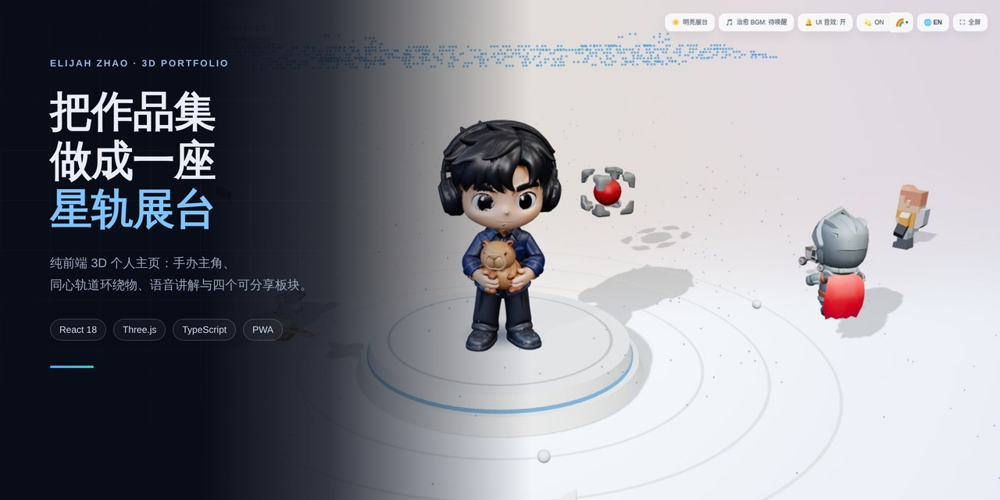
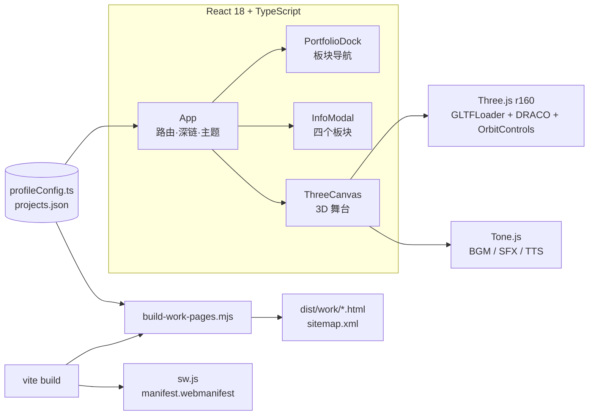

<p align="center">
  <a href="https://elijahzhao.github.io/Self-Introduction/">
    
  </a>
</p>

<h1 align="center">3D 互动个人星轨展台</h1>

<p align="center">
  <strong>把手办角色、星轨环绕物和语音讲解放进一个纯前端的 3D 作品集。</strong><br />
  四个板块可深链分享 · 中英双语 · WebGL2 失败可降级 · PWA 离线壳 · 零后端
</p>

<p align="center">
  <a href="https://github.com/ElijahZhao/Self-Introduction/actions/workflows/deploy.yml">
    
  </a>
  
  
  
</p>

<p align="center">
  <a href="https://elijahzhao.github.io/Self-Introduction/"><strong>🚀 在线展台</strong></a> ·
  <a href="https://elijahzhao.github.io/Self-Introduction/?p=about">关于我</a> ·
  <a href="https://elijahzhao.github.io/Self-Introduction/?p=projects">代表作品</a> ·
  <a href="https://elijahzhao.github.io/Self-Introduction/?p=hobbies">技能图谱</a> ·
  <a href="https://elijahzhao.github.io/Self-Introduction/?p=contact">联络交流</a>
</p>

<p align="center">
  简体中文 | <a href="README.en.md">English</a>
</p>

---

## 目录

- [这是什么](#what-is-this)
- [界面一览](#screens)
- [核心能力](#what-it-does)
- [架构](#architecture)
- [快速开始](#quick-start)
- [质量门禁](#quality-gates)
- [内容即配置](#content-as-configuration)
- [部署与离线能力](#deployment-and-offline)
- [已知限制](#known-limits)
- [维护状态](#maintenance-status)
- [许可与资产](#license-and-assets)

<a id="what-is-this"></a>

## 这是什么

一个可以直接打开、拖拽、点开的 3D 个人主页。它不把经历排成又一篇纯文本简历，而是做成一座绕轴运行的「星轨展台」：五个手办角色依次出场，土星、纸飞机、地月与能量球沿轨道运行，点开任一环绕物就进入对应板块。

- **四个板块**：关于我、代表作品、技能图谱、联络交流，每个都能单独分享（`?p=about` 等）。
- **七个作品档案**：项目卡之外，构建时会为每个项目生成一条可被搜索引擎读取的静态详情页（`/work/<slug>.html`）。
- **两种语言**：界面文案中英切换，`<html lang>` 同步更新。
- **零后端**：没有服务器、数据库或第三方 UI 依赖；构建产物直接托管在 GitHub Pages。

适合想看「3D 交互怎么落地」的开发者，也适合只想快速了解作者经历、不想读长文的人。

> 技术细节：React 18 · TypeScript 5.6 · Vite 6 · Three.js r160 · Tone.js · Tailwind CSS v4 · GSAP。

<a id="screens"></a>

## 界面一览

<p align="center">
  <a href="https://elijahzhao.github.io/Self-Introduction/">
    
  </a>
</p>

<p align="center">
  <sub>左：桌面端星轨舞台与底部导航坞 · 中：为竖屏单独取景 · 右：构建时生成、零 JS 的作品详情页</sub>
</p>

<a id="what-it-does"></a>

## 核心能力

| 能力 | 实现 | 怎么验证 |
|---|---|---|
| 3D 舞台 | Three.js 场景 + `OrbitControls` 视角漫游；角色待机呼吸由 `characterPivot` 位移驱动；四个交互环绕物 + 九个装饰环绕物沿同心轨道运行 | 同时渲染 3 个 canvas（舞台 / 极光背景 / 流体光标），无 `pageerror` |
| 角色切换 | 5 个 GLB 主角、底部导航坞切换；其余角色在当前主角加载完成后后台预取，切换不再二次请求 | 切换后 `localStorage` 记住选择，模型秒切 |
| 声音 | Tone.js 实时合成 BGM 与 UI 音效；弹窗优先播放真人语音，缺失时回退 Web Speech API | 首次手势后 AudioContext 正常唤醒 |
| 失败兜底 | `ErrorBoundary` + `StageFallback` 四种原因（无 WebGL2 / 上下文丢失 / 模型失败 / 组件异常），带重试与文字介绍入口 | 禁用 WebGL2、注入 `WEBGL_lose_context`、模型 404 三种场景均有可读卡片 |
| 移动端 | 竖屏单独缩放取景（`orbitWorld` + 0.6 缩放）；弹窗正文滚动提示；手机返回键关闭卡片而不是退出站点 | 390×844 与 1440×900 两档截图比对 |
| 可发现 | `index.html` 内置视觉隐藏但可爬取的中英正文、`Person` / `WebSite` JSON-LD、`LICENSE`、robots、sitemap 与 7 条静态作品页 | 搜索抓取看到正文；`/work/*.html` 直接 200 |
| 离线 / 统计 | manifest + 手写 Service Worker；统计默认静默，配置 `VITE_ANALYTICS_ENDPOINT` 后才发送，无 Cookie、尊重 DNT | 断网重载首页与作品页均 200；未配置时产物中 0 处上报端点 |

<a id="architecture"></a>

## 架构



构建顺序固定为：

```text
tsc → vite build → build-work-pages → build-pwa → size budget
```

任何一步失败，GitHub Actions 都不会部署。

<a id="quick-start"></a>

## 快速开始

要求 Node.js 20+，无需任何环境变量。

```bash
git clone https://github.com/ElijahZhao/Self-Introduction.git
cd Self-Introduction
npm ci
npm run dev
```

打开 `http://localhost:5173`。生产构建与本地预览：

```bash
npm run build
npx vite preview --port 4173
```

常用命令：

| 命令 | 作用 |
|---|---|
| `npm run dev` | 开发服务器（HMR） |
| `npm run build` | 类型检查 + 构建 + 生成作品页 + 写入 `sw.js` |
| `npm run typecheck` | 仅 `tsc --noEmit` |
| `npm run lint` | ESLint，`--max-warnings 0` |
| `npm run test` | Vitest 单元测试（纯逻辑） |
| `npm run test:e2e` | Playwright 冒烟：舞台、深链、返回键、主题、语言 |
| `npm run check:content` | 校验 `projects.json` 的 schema 与唯一 slug |
| `npm run check:size` | 产物体积预算，超限即失败 |

<a id="quality-gates"></a>

## 质量门禁

以下数字来自 2026-11-26 的构建，CI 每一步都会重跑：

| 门禁 | 当前结果 |
|---|---|
| TypeScript | `tsc --noEmit` 通过 |
| ESLint | 0 error / 0 warning（`--max-warnings 0`） |
| 单元测试 | 13 passed（`vitest`） |
| 端到端 | 3 passed（`playwright`，zh-CN） |
| 内容 schema | `projects.json OK.`（7 个项目，唯一 slug） |
| 产物体积 | 10.04 MiB 总量 · 1172 KiB app JS · 613 KiB 最大 chunk · 44 KiB CSS |
| 部署 | `Deploy to GitHub Pages` workflow 在 `main` 上自动执行 |

体积预算写死在 `scripts/check-dist-size.mjs`：总量 ≤ 12 MiB、app JS ≤ 1.25 MiB、单 chunk ≤ 0.65 MiB、CSS ≤ 60 KiB。超一点就构建失败，避免“下次再优化”变成永远不优化。

<a id="content-as-configuration"></a>

## 内容即配置

项目卡不写在组件里，而是集中在 [`src/data/projects.json`](src/data/projects.json)：

```json
{
  "version": 2,
  "updatedAt": "2026-11-26",
  "projects": [
    {
      "slug": "cinerec",
      "name": "CineRec",
      "tagline": "多模态电影推荐系统",
      "desc": "……",
      "tech": ["Python", "PyTorch", "FastAPI"],
      "highlights": ["……"],
      "repoUrl": "https://github.com/ElijahZhao/cinerec",
      "papers": [
        { "title": "CineRec: A Practical Multi-Modal Recommender Study…", "url": "https://doi.org/…" }
      ]
    }
  ]
}
```

- `slug` 唯一（kebab-case），同时决定静态页地址 `/work/<slug>.html`；改一个文件，详情页与 `sitemap.xml` 自动重建。
- 可选 `papers` 会渲染成「预印本」入口，并把 DOI 写进详情页 `CreativeWork` 的 `citation`。
- `npm run check:content` 在 CI 构建前执行；字段写错、slug 重复、URL 非法都会直接拦住部署。

<a id="deployment-and-offline"></a>

## 部署与离线能力

- **部署**：推送 `main` 后，GitHub Actions 依次执行 typecheck → lint → unit → content schema → build → size budget → e2e，再上传 Pages artifact。详见 [`.github/workflows/deploy.yml`](.github/workflows/deploy.yml)。
- **PWA**：构建产物含 `manifest.webmanifest` 与 `sw.js`（每次构建换 cache id，activate 清旧缓存）。导航请求走 network-first，避免旧 HTML 壳挡住新版本；`/assets/`、`/models/`、`/draco/`、`/audio/` 走 stale-while-revalidate。开发模式不注册 Service Worker。
- **统计（默认关闭）**：构建时设置 `VITE_ANALYTICS_ENDPOINT` 才启用；载荷只有 `event / path / lang / ts / detail`，无 Cookie、无访客 ID，并尊重 `Do Not Track`。事件：`page_view`、`module_open`、`persona_switch`、`project_page_open`。
- **深链**：`?p=about`、`?p=projects`、`?p=hobbies`、`?p=contact`；`Esc` 或手机返回键关闭卡片，不会把页面退出去。

<a id="known-limits"></a>

## 已知限制

- **WebGL2 是硬门槛**：不支持时不会白屏，但只剩文字介绍卡，3D 体验不可用。
- **首次加载有模型成本**：`dist` 约 10 MiB；正常网络等主角 + 土星 / 地月 / 能量球，弱网降到只等主角 + 能量球，其余装饰物后台补载。
- **内容改动需要重新构建**：没有 CMS 或后端，改项目请编辑 `projects.json` 后重新部署。
- **角色是静态 GLB**：没有骨骼动画，呼吸与入场靠代码位移/补间；更换主角模型需重新走减面、WebP 贴图与 Draco 管线。
- **单人维护**：更新节奏取决于作者时间，但 CI 会保证每次提交不破坏构建与冒烟测试。

<a id="maintenance-status"></a>

## 维护状态

| 状态 | 内容 |
|---|---|
| ✅ 已上线 | 深链与返回键、静态可读内容、PWA 离线壳、作品详情页、内容 schema、可选统计、e2e + 体积预算 |
| ⏸️ 暂缓 | 主角 GLB 替换、双锁文件治理、真机入场时长复测、长线作品化扩展（均已明确不在当前范围） |
| 💬 欢迎 | Bug 报告、文案纠错、可访问性建议；请开 [Issue](https://github.com/ElijahZhao/Self-Introduction/issues) |

<a id="license-and-assets"></a>

## 许可与资产

- **代码**：MIT，见 [LICENSE](LICENSE)。
- **第三方资产**：不适用 MIT。完整来源、体积、三角面与授权义务见 [`docs/ASSETS.md`](docs/ASSETS.md)。
- **必须保留的署名**：`Wolf.glb` 为 **CC-BY 4.0**，转载或衍生须署名 [vinceyanez](https://sketchfab.com/vinceyanez)；Quaternius / Kenney / KayKit 素材为 CC0-1.0；五个主角模型与语音文件版权归作者所有。

<p align="center">
  <sub>Built with React, Three.js and too many orbit calculations.</sub>
</p>
